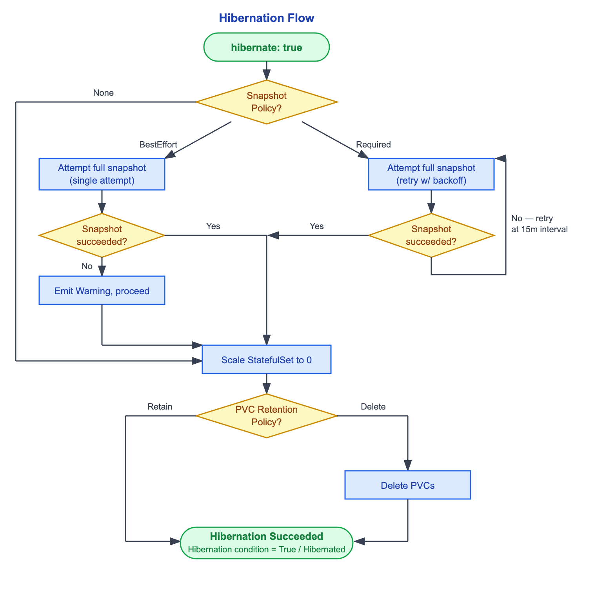
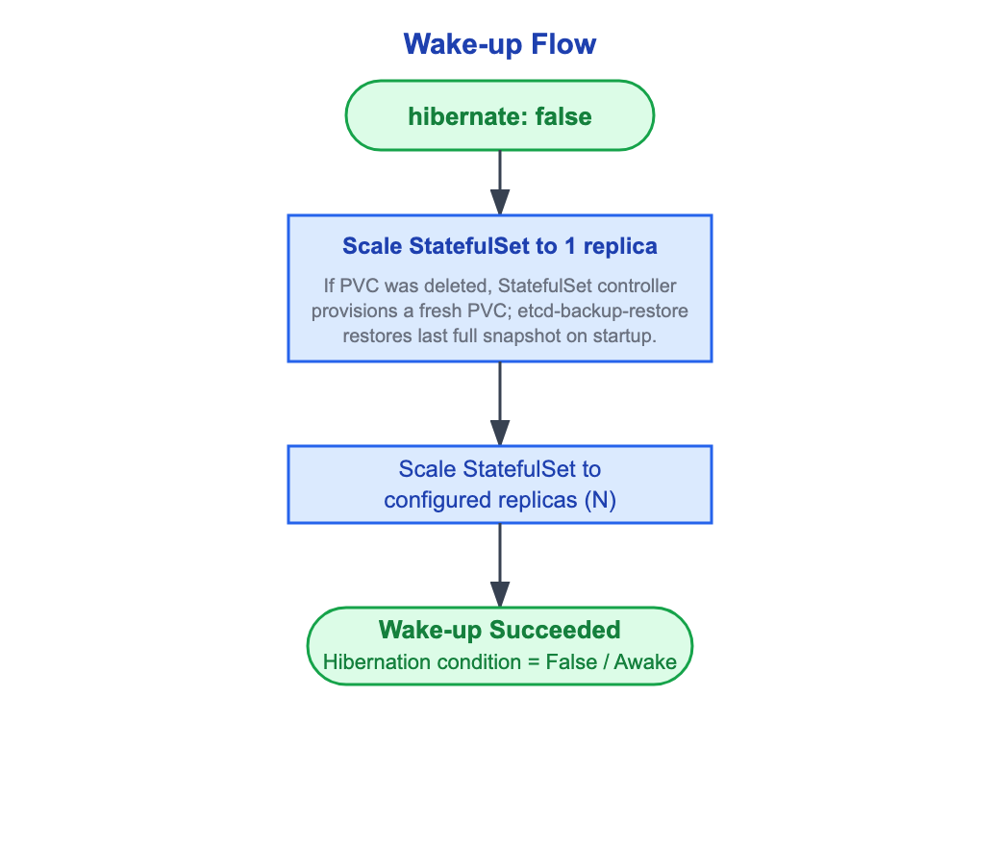
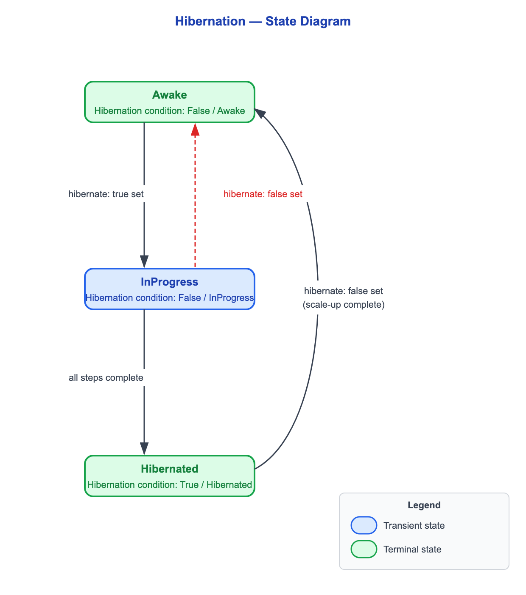

# DEP-09: Hibernation and wake-up of an etcd cluster managed by `etcd-druid`

## Summary

Hibernating an etcd cluster — scaling it to zero to save cost while preserving the ability to restore it later — has no first-class API in `etcd-druid` today. Consumers must implement the hibernation workflow themselves, with no reusable, well-defined signal to express intent or configure behaviour.

This proposal introduces a declarative hibernation API on the `Etcd` resource, allowing consumers to signal hibernation intent and configure its behaviour. `etcd-druid` owns the entire workflow end to end and reports progress so consumers can observe it.

## Terminology

- **Hibernation:** Scaling an etcd cluster to zero replicas while preserving the ability to restore it later.
- **Wake-up:** The reverse of hibernation — restoring the etcd cluster to a fully running and usable state.
- **Scale-to-zero:** Setting StatefulSet replica count to zero, terminating all pods.
- **Full snapshot:** A complete point-in-time capture of the etcd keyspace, written to the configured object store by the `etcd-backup-restore` sidecar.

## Motivation

`etcd-druid` has no first-class hibernation API. Today, hibernating an etcd cluster means overloading `etcd.spec.replicas: 0` — but that field expresses the desired cluster size, not a hibernation intent. Using it to hibernate conflates two concerns: the consumer loses its record of the real cluster size (it must remember the original replica count externally to wake the cluster back up), and the field carries no semantics about what should happen to data or storage around the scale-down. Any consumer that wants to hibernate safely must implement the full sequencing — snapshot, scale-down, and volume handling — itself.

### Use cases

**1. Cost saving.**
Operators want to scale idle etcd clusters to zero and optionally reclaim their persistent volumes to save cost. This requires safe sequencing — capturing a full snapshot before deleting volumes so the cluster can be restored on wake-up. Today `etcd-druid` provides no mechanism to express or enforce this.

**2. Separation of responsibility.**
Hibernating an etcd cluster is an etcd concern and should be owned by `etcd-druid`. Today consumers such as Gardener handle etcd hibernation themselves. The correct boundary is for consumers to signal intent and for `etcd-druid` to act on it, consistently, for all consumers.

### Goals

- Provide a declarative API on the `Etcd` resource to hibernate and wake up a cluster.
- Allow consumers to configure whether and how a full snapshot is taken before scale-to-zero.
- Allow consumers to configure whether persistent volume claims are retained or deleted after scale-to-zero.
- Report hibernation progress and outcome through the `Etcd` resource so consumers can observe the current state.

### Non-Goals

- Guaranteeing zero in-flight writes at the point of hibernation.
- Automatic hibernation scheduling. Scheduling is the consumer's responsibility.

## Proposal

### Approach

Etcd hibernation is driven by a new `spec.hibernate` field on the `Etcd` resource. Setting it to `true` signals intent to hibernate the etcd cluster; setting it back to `false` triggers wake-up. The `etcd-druid` controller reconciles toward the desired state. Additionally, the hibernation behaviour is configured via `spec.hibernationPolicy`, which applies to all hibernate/wake-up cycles. A new feature gate will be introduced to gate this functionality, ensuring backward compatibility for existing consumers.

The hibernation workflow is:

1. **Full snapshot** (optional, governed by `spec.hibernationPolicy.fullSnapshot.policy`)
2. **Scale-to-zero** — set `StatefulSet.spec.replicas` to `0`
3. **PVC deletion** (optional, governed by `spec.hibernationPolicy.pvcRetentionPolicy`)

The wake-up workflow is the reverse. `etcd-druid` only performs the scale operations; PVC (re)provisioning and snapshot restore happen automatically as side-effects of scaling up:

1. **Scale to 1 replica** — bring one member up first. If its PVC was deleted during hibernation, the StatefulSet controller provisions a fresh PVC from the `volumeClaimTemplate`, and the `etcd-backup-restore` sidecar restores from the last full snapshot before etcd starts. If the PVC was retained, the existing volume is reused and no restore occurs.
2. **Scale to configured replicas** — scale out to `spec.replicas`

Progress and outcome are reported through a new `Hibernation` condition in `etcd.status.conditions`.

The flow diagrams below illustrate the primary paths:





### API changes

#### `Etcd` spec

Two new fields are added to `EtcdSpec`:

```go
type EtcdSpec struct {
    // Hibernate signals the desired hibernation intent.
    // true = hibernate, false = wake up.
    // +optional
    // +kubebuilder:default=false
    Hibernate *bool `json:"hibernate,omitempty"`

    // HibernationPolicy configures how hibernation is performed.
    // +optional
    HibernationPolicy *HibernationPolicy `json:"hibernationPolicy,omitempty"`
}
```

#### `HibernationPolicy`

```go
// HibernationPolicy governs how an etcd cluster is hibernated.
type HibernationPolicy struct {
    // PVCRetentionPolicy controls whether etcd PersistentVolumeClaims are retained
    // or deleted after the cluster is scaled to zero.
    // +optional
    // +kubebuilder:default=Retain
    PVCRetentionPolicy *HibernationPVCRetentionPolicy `json:"pvcRetentionPolicy,omitempty"`

    // FullSnapshot configures the full snapshot taken before scale-to-zero.
    // +optional
    FullSnapshot *HibernationSnapshotConfig `json:"fullSnapshot,omitempty"`
}

// HibernationPVCRetentionPolicy defines what happens to etcd PVCs on hibernation.
// +kubebuilder:validation:Enum=Retain;Delete
type HibernationPVCRetentionPolicy string

const (
    // HibernationPVCRetentionPolicyRetain keeps PVCs intact so the cluster can
    // restart from existing disks on wake-up. This is the default.
    HibernationPVCRetentionPolicyRetain HibernationPVCRetentionPolicy = "Retain"

    // HibernationPVCRetentionPolicyDelete deletes PVCs after scale-to-zero,
    // releasing the underlying disks.
    HibernationPVCRetentionPolicyDelete HibernationPVCRetentionPolicy = "Delete"
)
```

#### `HibernationSnapshotConfig`

```go
// HibernationSnapshotConfig configures the full snapshot taken before scale-to-zero.
type HibernationSnapshotConfig struct {
    // Policy controls the snapshot behaviour before scale-to-zero.
    //   - None: no snapshot is taken.
    //   - BestEffort: a single snapshot attempt is made; hibernation proceeds
    //     regardless of outcome. A Warning event is emitted on failure.
    //   - Required: the snapshot is retried with exponential backoff. Hibernation
    //     is blocked until the snapshot succeeds.
    // +kubebuilder:default=None
    Policy FullSnapshotPolicy `json:"policy"`
}

// FullSnapshotPolicy defines whether and how strictly a full snapshot is taken
// before the etcd cluster is scaled to zero on hibernation.
// +kubebuilder:validation:Enum=None;BestEffort;Required
type FullSnapshotPolicy string

const (
    // FullSnapshotPolicyNone takes no snapshot before hibernating. Default.
    FullSnapshotPolicyNone FullSnapshotPolicy = "None"

    // FullSnapshotPolicyBestEffort makes a single snapshot attempt and proceeds
    // regardless of outcome. A Warning event is emitted on failure.
    FullSnapshotPolicyBestEffort FullSnapshotPolicy = "BestEffort"

    // FullSnapshotPolicyRequired retries the snapshot with exponential backoff
    // until it succeeds. Hibernation is blocked until the snapshot completes.
    FullSnapshotPolicyRequired FullSnapshotPolicy = "Required"
)
```

#### `Etcd` status — `Hibernation` condition

A new `Hibernation` condition is added to `etcd.status.conditions`:

```go
const (
    ConditionTypeHibernation ConditionType = "Hibernation"
)
```

| `status` | `reason` | Meaning |
|----------|----------|---------|
| `False` | `Awake` | Cluster is running normally. Initial state; also set after wake-up completes. |
| `False` | `InProgress` | Hibernation is in progress (snapshot, scale-to-zero, or PVC deletion). |
| `True` | `Hibernated` | Cluster is fully hibernated. |

The condition is never removed — like all other druid conditions it persists and transitions. The `message` field carries a human-readable description of the current step (e.g., `"Taking full snapshot before scale-to-zero"`).

### Snapshot retry behaviour

The snapshot is triggered via an `EtcdOpsTask` (`OnDemandSnapshot`). The `etcd-druid` controller creates a new task per attempt, gating the next hibernation step on a `Succeeded` outcome. A terminal `Failed` task causes the `etcd-druid` controller to create a new task on the next reconcile. Exponential backoff between attempts will be introduced as part of this proposal.

| Policy | Retry behaviour | On failure |
|--------|----------------|------------|
| `None` | No snapshot attempted | — |
| `BestEffort` | Single attempt, no retry | Emit Warning event, proceed to scale-to-zero |
| `Required` | Retry with exponential backoff, 5s → 15m ceiling | Keep retrying at 15m interval; `Hibernation` condition stays `False / InProgress` |

For `Required`, the `etcd-druid` controller never gives up. The external backstop is consumer-defined.

The `EtcdOpsTask` snapshot timeout follows the existing implementation: `OnDemandSnapshotConfig.TimeoutSecondsFull` (default 900 seconds).

### State diagram

The diagram below shows the observable states of the `Hibernation` condition and the transitions between them:



### Druid migration path

`etcd-druid` already takes a snapshot before scaling to zero today, as a side-effect of the `StatefulSet` component's `PreSync` step. `ensurePreSyncSnapshotIfNeeded` uses `etcd.spec.replicas == 0` as a proxy for "the cluster is being hibernated": when the backup store is enabled and the spec requests zero replicas, it sequences a full-snapshot `EtcdOpsTask` (`presync-snapshot-hibernation-<generation>-<index>`) via `ensurePreSyncSnapshot` before the StatefulSet is scaled down. This path retries up to a fixed number of attempts and then proceeds with the scale-down regardless of the snapshot outcome.
This proposal does not remove that behaviour. Instead, the existing `replicas == 0` snapshot path is placed behind the new feature gate so that it only runs when the gate is **disabled**:

- **Feature gate disabled** — the existing `PreSync` snapshot path is preserved unchanged (`replicas == 0` continues to act as the hibernation proxy). This keeps the current behaviour intact for consumers that have not yet adopted the new API.
- **Feature gate enabled** — the `replicas == 0` proxy path is skipped, and hibernation is driven entirely by the new `spec.hibernate` field and `spec.hibernationPolicy`, which own snapshotting, scale-to-zero, and PVC handling end to end.

This preserves backward compatibility while the dedicated API becomes the single source of truth for hibernation.

#### `spec.replicas` remains the source of truth

Setting `spec.hibernate: true` does **not** change `etcd.spec.replicas`. The configured replica count stays intact throughout hibernation and remains the single source of truth for the cluster size. On wake-up, `etcd-druid` scales the cluster back up to `spec.replicas` — the original count was never lost because it was never overwritten. This is a departure from the current Gardener flow, which overwrites `spec.replicas: 0` and relies on the consumer to remember the original count externally. By leaving `spec.replicas` untouched, `etcd-druid` owns the count itself and does not depend on any consumer bookkeeping.

A consequence is an expected divergence while hibernated: `spec.replicas` reflects the desired cluster size (e.g. `3`), while the `StatefulSet` runs `0` replicas. `etcd-druid` must treat this as the intended steady state and not reconcile the StatefulSet back up to `spec.replicas`.

#### Where hibernation is checked in the code

Two touch-points in the `StatefulSet` component must consult the hibernation signal:

- **StatefulSet replica target** — the component currently patches the StatefulSet to `etcd.Spec.Replicas` unconditionally (`createOrPatch` → `createOrPatchWithReplicas`). When hibernation reaches the scale-down step (i.e. after the full snapshot step has completed per `spec.hibernationPolicy`), the target replica count must be overridden to `0`, so the StatefulSet is scaled down while `spec.replicas` is left unchanged. While hibernation is still in progress on an earlier step — for example, the full snapshot is still being taken — the StatefulSet must not yet be patched to `0`; it retains its current replica count until the scale-down step is reached.
- **Pre-sync snapshot trigger** — `ensurePreSyncSnapshotIfNeeded` currently keys the hibernation snapshot off `etcd.Spec.Replicas == 0`. With the feature gate enabled, this trigger must instead key off `spec.hibernate`, since `spec.replicas` no longer drops to `0` during hibernation.

Because `spec.replicas` is never changed by hibernation, the existing CEL scale-validation rules on `spec.replicas` (scale-out, scale-in, and scale-to-zero guards tied to the `ScaleOperationComplete` condition) are not triggered by a hibernation toggle and remain unaffected.

### Gardener migration path

Currently, Gardener triggers the hibernation of an etcd cluster. The relevant steps are:

1. **`ScaleETCDToZero`** — patches the `Etcd` CR directly: sets `spec.replicas: 0` and adds the `gardener.cloud/operation: reconcile` annotation. This is the actual hibernation signal that druid acts on.
2. **`WaitUntilEtcdsReady`** — polls the `Etcd` CR every 5 seconds (up to 5 minutes) waiting for druid to acknowledge: `status.observedGeneration == metadata.generation` and the annotation removed. When `spec.replicas == 0`, pod readiness checks are skipped entirely.

Gardener retries a failed shoot reconcile for up to 12 hours (`RetryDuration`) before marking it permanently `Failed`.

To adopt the new API, Gardener replaces the `ScaleETCDToZero` patch with a `spec.hibernate: true` update and configures `spec.hibernationPolicy` to match the desired snapshot and PVC retention behaviour. A new feature gate will be introduced to gate this functionality, ensuring backward compatibility for existing consumers.

The `WaitUntilEtcdsReady` polling logic remains unchanged — it already handles `spec.replicas == 0` by skipping pod readiness checks, and the `Hibernation` condition provides an additional observable signal for consumers that want finer-grained progress reporting.

The member lease component already handles `spec.replicas == 0` by preserving the member leases instead of deleting them, so they are available when the cluster wakes up. This behaviour is unchanged by this proposal.

### Compaction controller guard

The compaction controller has no guard for a hibernated cluster. It reconciles when snapshot leases or its compaction job change. On a hibernated cluster the delta over the last full snapshot stops advancing and no new leases change, so the controller usually goes quiet — but it can still take a path that contacts the now-absent cluster.

The full snapshot trigger (`triggerFullSnapshot`) issues an HTTP request to the `etcd-backup-restore` sidecar through the client service. With zero replicas the service has no endpoints, so the request fails and the reconcile is requeued with backoff, retrying until the condition clears. This trigger fires in two cases, both of which can occur while hibernated:

- The accumulated delta since the last full snapshot is at or above `triggerFullSnapshotThreshold`. A full snapshot taken as part of the hibernation flow resets this delta to near zero, so this case is avoided when `fullSnapshot.policy` is `BestEffort` or `Required`. It is **not** avoided under the default `None`, or when a `BestEffort` snapshot fails — in either case a cluster that hibernates with a large accumulated delta trips the threshold on the first reconcile.
- The last compaction status condition was a deadline-exceeded or full-snapshot failure. This is independent of the delta, so it fires even when a full snapshot was taken immediately before scale-to-zero.

Because the trigger does not depend solely on the delta, taking a snapshot before hibernation is not sufficient on its own. A guard must be added to skip compaction reconciliation when `StatefulSet.spec.replicas == 0`, consistent with the existing early-return when backups are disabled.

## Alternatives

### Add a `RetryTimeout` to bound snapshot retries

A `retryTimeout` field was considered on `HibernationSnapshotConfig` to bound how long the `etcd-druid` controller retries a failing snapshot. **Rejected** because retrying indefinitely is the correct contract for a Kubernetes operator: the controller should keep making progress on every reconcile and leave timeout decisions to the consumer's own retry policy. For Gardener, the 12-hour `RetryDuration` is already the backstop. A `retryTimeout` would add API surface, require classification of transient vs. terminal errors, and introduce a failure terminal that the operator cannot self-heal from.

This rejection applies only to the new `Required` semantics under the feature gate. The legacy gate-off path (`replicas == 0`) retains its existing bounded-retry-then-proceed behaviour, as described in [Druid migration path](#druid-migration-path).

## Metrics

The following metrics will be introduced, following the convention of the existing compaction metrics (namespace `etcddruid`, subsystem `hibernation`, label `etcd_namespace`):

- `etcddruid_hibernation_state`
  Gauge — the current hibernation state of the cluster, so operators can see across a landscape how many clusters are hibernated, awake, or mid-transition.
  Labels:
  - `etcd_namespace` — namespace of the target `Etcd` resource.
  - `state` — one of `awake`, `inProgress`, `hibernated`, mirroring the `Hibernation` condition reasons. The value is `1` for the current state and `0` for the others.

- `etcddruid_hibernation_duration_seconds`
  Histogram — wall-clock time taken to complete a hibernation or wake-up, measured from the first reconcile of the intent to the terminal `Hibernation` condition. Surfaces clusters taking abnormally long to hibernate or wake up.
  Labels:
  - `etcd_namespace` — namespace of the target `Etcd` resource.
  - `direction` — one of `hibernate`, `wakeup`.

## References

- [etcd-druid issue #922 — Hibernation support](https://github.com/gardener/etcd-druid/issues/922)
