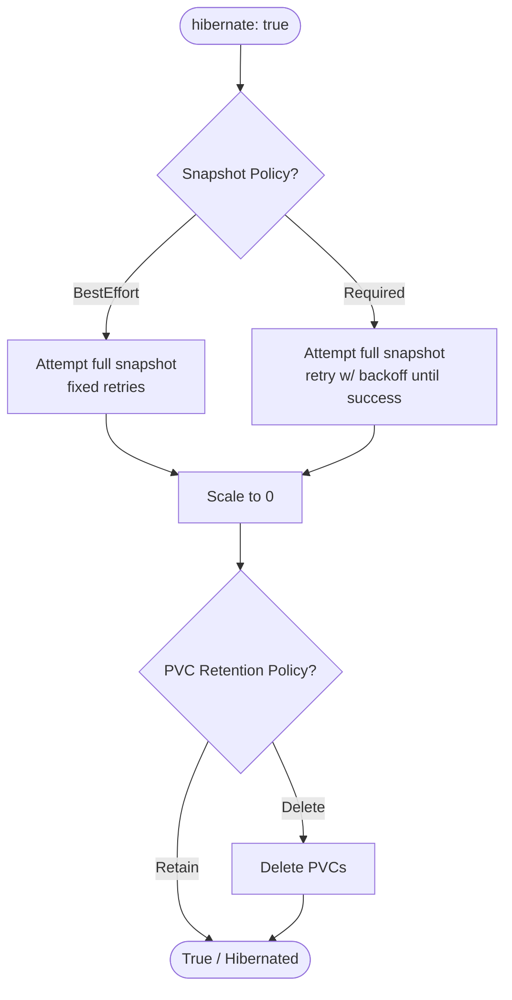
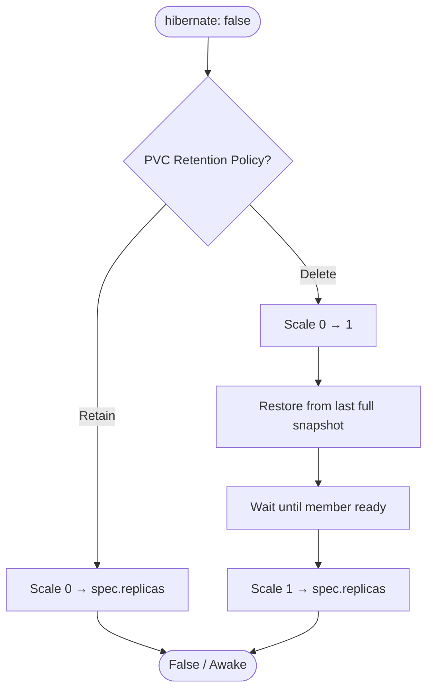
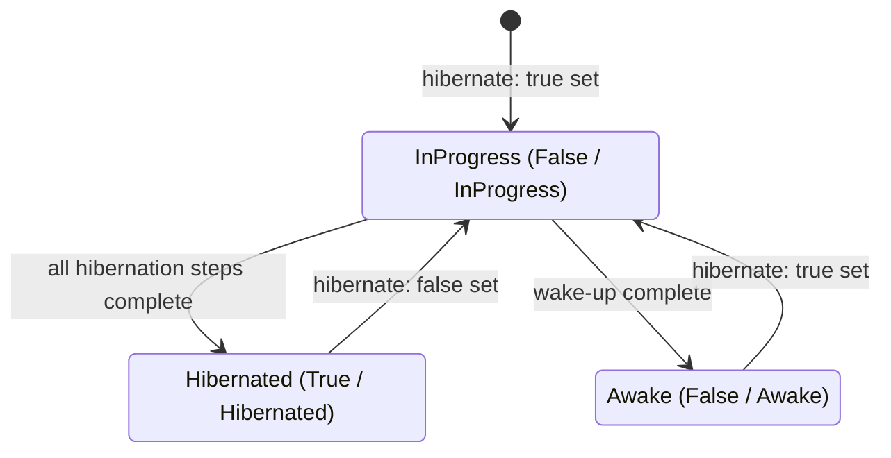

# DEP-09: Hibernation and wake-up of an etcd cluster managed by `etcd-druid`

## Summary

Hibernating an etcd cluster — scaling it to zero to save cost while preserving the ability to restore it later — has no first-class API in `etcd-druid` today. Consumers must implement the hibernation workflow themselves, with no reusable, well-defined signal to express intent or configure behaviour.

This proposal introduces a declarative hibernation API on the `Etcd` resource, allowing consumers to signal hibernation intent and configure its behaviour. `etcd-druid` owns the entire workflow end to end and reports progress so consumers can observe it.

## Terminology

- **Hibernation:** Scaling an etcd cluster to zero replicas while preserving the ability to restore it later.
- **Wake-up:** The reverse of hibernation — restoring the etcd cluster to a fully running and usable state.
- **Scale-to-zero:** Setting StatefulSet replica count to zero, terminating all pods.
- **Full snapshot:** A complete point-in-time capture of the etcd keyspace, written to the configured object store by the `etcd-backup-restore` sidecar.
- **Data loss acceptance:** An explicit consumer declaration that the data in a cluster is disposable, relaxing snapshot and storage policy requirements on hibernation.

## Motivation

`etcd-druid` has no first-class hibernation API. Today, hibernating an etcd cluster means overloading `etcd.spec.replicas: 0` — but that field expresses the desired cluster size, not a hibernation intent. Using it to hibernate conflates two concerns: the consumer loses its record of the real cluster size (it must remember the original replica count externally to wake the cluster back up), and the field carries no semantics about what should happen to data or storage around the scale-down. Any consumer that wants to hibernate safely must implement the full sequencing — snapshot, scale-down, and volume handling — itself.

### Use cases

**1. Cost saving.**
Operators want to scale idle etcd clusters to zero and optionally reclaim their persistent volumes to save cost. This requires safe sequencing — capturing a full snapshot before deleting volumes so the cluster can be restored on wake-up. Today `etcd-druid` provides no mechanism to express or enforce this.

**2. Separation of responsibility.**
Hibernating an etcd cluster is an etcd concern and should be owned by `etcd-druid`. Today consumers such as Gardener handle etcd hibernation themselves. The correct boundary is for consumers to signal intent and for `etcd-druid` to act on it, consistently, for all consumers.

### Goals

- Provide a declarative API on the `Etcd` resource to hibernate and wake up a cluster.
- Allow consumers to configure whether and how a full snapshot is taken before scale-to-zero.
- Allow consumers to configure whether persistent volume claims are retained or deleted after scale-to-zero.
- Allow consumers to explicitly accept data loss for disposable-data clusters, relaxing snapshot and storage policies.
- Report hibernation progress and outcome through the `Etcd` resource so consumers can observe the current state.

### Non-Goals

- Guaranteeing zero in-flight writes at the point of hibernation.
- Automatic hibernation scheduling. Scheduling is the consumer's responsibility.

## Proposal

### Approach

Etcd hibernation is driven by a new `spec.hibernate` field on the `Etcd` resource. Setting it to `true` signals intent to hibernate the etcd cluster; setting it back to `false` triggers wake-up. The `etcd-druid` controller reconciles toward the desired state. Hibernation behaviour is configured via `spec.hibernationPolicy`, which applies to all hibernate/wake-up cycles.

The hibernation workflow includes:

1. **Full snapshot** (optional, governed by `spec.hibernationPolicy.fullSnapshot.policy`)
2. **Scale-to-zero** — set `StatefulSet.spec.replicas` to `0`
3. **PVC deletion** (optional, governed by `spec.hibernationPolicy.pvcRetentionPolicy`)

The wake-up workflow is the reverse. The sequence depends on `spec.hibernationPolicy.pvcRetentionPolicy` — the two policies leave the cluster in fundamentally different states and require different scale-up sequences.

Progress and outcome are reported through a new `Hibernated` condition in `etcd.status.conditions`.

The flow diagrams below illustrate the primary paths:

**Hibernation flow**



**Wake-up flow**



#### Wake-up sequence

**`Retain` — scale `0 → spec.replicas` directly (all members at once).**
The data volumes are intact. Each member restarts from its existing data directory, which still records the full cluster membership. Brought up together, the members re-establish connections and re-form quorum, exactly as in an ordinary cluster restart. This is the single-step scale that `etcd-druid` already performs today. A staged `0 → 1 → N` wake-up must **not** be used here: a lone member resuming a data directory that records an N-member cluster cannot reach quorum on its own (it holds 1 of N votes), never becomes ready, and a readiness-gated scale-out would stall indefinitely.

**`Delete` — scale `0 → 1`, wait for readiness, then `1 → spec.replicas` (staged).**
The data volumes were deleted, so there is nothing to resume. The first member comes up with a fresh volume and the `etcd-backup-restore` sidecar restores from the last full snapshot, bootstrapping a **fresh single-member** cluster (quorum 1 of 1) that becomes ready on its own. Only after it is ready does `etcd-druid` scale out; the remaining members come up with fresh volumes and join the running member as learners. A direct `0 → N` must **not** be used here: all members would independently restore the same snapshot and bootstrap disjoint single-member clusters — a split brain.

### API changes

#### `Etcd` spec

Two new fields are added to `EtcdSpec`:

```go
type EtcdSpec struct {
    // Hibernate signals the desired hibernation intent.
    // true = hibernate, false = wake up.
    // +optional
    // +kubebuilder:default=false
    Hibernate *bool `json:"hibernate,omitempty"`

    // HibernationPolicy configures how hibernation is performed.
    // +optional
    HibernationPolicy *HibernationPolicy `json:"hibernationPolicy,omitempty"`
}
```

#### `HibernationPolicy`

```go
// HibernationPolicy governs how an etcd cluster is hibernated.
type HibernationPolicy struct {
    // PVCRetentionPolicy controls whether etcd PersistentVolumeClaims are retained
    // or deleted after the cluster is scaled to zero.
    // +optional
    // +kubebuilder:default=Retain
    PVCRetentionPolicy *HibernationPVCRetentionPolicy `json:"pvcRetentionPolicy,omitempty"`

    // FullSnapshot configures the full snapshot taken before scale-to-zero.
    // +optional
    FullSnapshot *HibernationSnapshotConfig `json:"fullSnapshot,omitempty"`

    // AcceptDataLoss, when true, declares that the data in this cluster is
    // disposable and that permanent data loss on hibernation is acceptable.
    // It bypasses the validations that require a backup store and a guaranteed
    // snapshot before PVCs are deleted. Set this only for clusters whose data
    // has no value (e.g. an events-only etcd with no backup).
    // +optional
    // +kubebuilder:default=false
    AcceptDataLoss *bool `json:"acceptDataLoss,omitempty"`
}

// HibernationPVCRetentionPolicy defines what happens to etcd PVCs on hibernation.
// Deleting a PVC removes the claim object; whether the underlying PV is released
// or deleted is governed by the StorageClass reclaim policy.
// +kubebuilder:validation:Enum=Retain;Delete
type HibernationPVCRetentionPolicy string

const (
    // HibernationPVCRetentionPolicyRetain keeps PVCs intact so the cluster can
    // restart from existing disks on wake-up. This is the default.
    HibernationPVCRetentionPolicyRetain HibernationPVCRetentionPolicy = "Retain"

    // HibernationPVCRetentionPolicyDelete deletes PVCs after scale-to-zero,
    // releasing the underlying disks.
    HibernationPVCRetentionPolicyDelete HibernationPVCRetentionPolicy = "Delete"
)
```

#### `HibernationSnapshotConfig`

```go
// HibernationSnapshotConfig configures the full snapshot taken before scale-to-zero.
type HibernationSnapshotConfig struct {
    // Policy controls the snapshot behaviour before scale-to-zero.
    //   - BestEffort: a fixed number of snapshot attempts are made; hibernation
    //     proceeds regardless of outcome. A Warning event is emitted on failure.
    //   - Required: the snapshot is retried with exponential backoff. Hibernation
    //     is blocked until the snapshot succeeds.
    // +kubebuilder:default=BestEffort
    Policy FullSnapshotPolicy `json:"policy"`

    // TimeoutSeconds overrides the per-attempt timeout for the full snapshot
    // taken before scale-to-zero. When unset, the existing default (900 seconds)
    // applies; the minimum of 120 seconds is enforced.
    // +optional
    // +kubebuilder:validation:Minimum=120
    TimeoutSeconds *int32 `json:"timeoutSeconds,omitempty"`
}

// FullSnapshotPolicy defines how strictly a full snapshot is taken
// before the etcd cluster is scaled to zero on hibernation.
// +kubebuilder:validation:Enum=BestEffort;Required
type FullSnapshotPolicy string

const (
    // FullSnapshotPolicyBestEffort makes a fixed number of snapshot attempts and
    // proceeds regardless of outcome. A Warning event is emitted on failure.
    FullSnapshotPolicyBestEffort FullSnapshotPolicy = "BestEffort"

    // FullSnapshotPolicyRequired retries the snapshot with exponential backoff
    // until it succeeds. Hibernation is blocked until the snapshot completes.
    FullSnapshotPolicyRequired FullSnapshotPolicy = "Required"
)
```

#### Valid policy combinations and validation

The retention and snapshot policies interact: deleting PVCs removes the only on-disk copy of the data, so it is only safe when a guaranteed snapshot exists to restore from. The following rules are enforced at admission time (CEL validation on the `Etcd` resource). They are all relaxed when `acceptDataLoss: true`.

| `acceptDataLoss` | `pvcRetentionPolicy` | `fullSnapshot.policy` | Backup store | Verdict |
|------------------|----------------------|------------------------|--------------|---------|
| `false` (default) | `Retain` | `BestEffort` or `Required` | configured | Valid |
| `false` | `Delete` | `Required` | configured | Valid |
| `false` | `Delete` | `BestEffort` | — | **Rejected** — a best-effort snapshot may fail, destroying the only copy |
| `false` | any | `BestEffort` or `Required` | not configured | **Rejected** — snapshot policy needs a backup store to write to |
| `true` | `Delete` or `Retain` | any | optional | Valid — data loss is explicitly accepted |

The rules, stated plainly:

1. **A snapshot policy requires a backup store.** `fullSnapshot.policy` (`BestEffort` or `Required`) is meaningless without `spec.backup.store` — there is nowhere to write the snapshot. Rejected unless `acceptDataLoss: true`.
2. **`Delete` requires `Required`.** `pvcRetentionPolicy: Delete` must be paired with `fullSnapshot.policy: Required` so a snapshot is guaranteed before the disks are removed. `BestEffort` is not sufficient — a failed attempt would still delete the only copy. Rejected unless `acceptDataLoss: true`.
3. **`Delete` requires a backup store.** By rule 2, `Delete` implies `Required`, which by rule 1 implies a backup store. So `pvcRetentionPolicy: Delete` without a configured backup store is rejected unless `acceptDataLoss: true`. A consumer that hits this must either configure a backup store, switch to `Retain`, or set `acceptDataLoss: true`.

`acceptDataLoss: true` is the single, explicit opt-in for disposable-data clusters (for example an events-only etcd with no backup store, as in [etcd-druid#887](https://github.com/gardener/etcd-druid/issues/887)). It is the only way to delete PVCs without a guaranteed snapshot; the loss is accepted by contract rather than inferred from a silent default.

#### CEL validation rules

The rejection rules are enforced as `+kubebuilder:validation:XValidation` markers on the `Etcd` resource. Rules 1 and 2 enforce the policy-combination matrix above; Rule 3 enforces the [consumer migration guard](#consumer-migration-path); Rule 4 enforces the [`Retain` decrease guard](#spec-replicas-changes-while-hibernated).

```go
// Rule 1: snapshot policy requires a backup store (unless acceptDataLoss).
// +kubebuilder:validation:XValidation:message="fullSnapshot.policy requires spec.backup.store to be configured; set acceptDataLoss: true to override.",rule="!has(self.spec.hibernationPolicy) || !has(self.spec.hibernationPolicy.fullSnapshot) || (has(self.spec.hibernationPolicy.acceptDataLoss) && self.spec.hibernationPolicy.acceptDataLoss == true) || has(self.spec.backup.store)"

// Rule 2: pvcRetentionPolicy: Delete requires fullSnapshot.policy: Required (unless acceptDataLoss).
// +kubebuilder:validation:XValidation:message="pvcRetentionPolicy: Delete requires fullSnapshot.policy: Required; set acceptDataLoss: true to override.",rule="!has(self.spec.hibernationPolicy) || !has(self.spec.hibernationPolicy.pvcRetentionPolicy) || self.spec.hibernationPolicy.pvcRetentionPolicy != 'Delete' || (has(self.spec.hibernationPolicy.acceptDataLoss) && self.spec.hibernationPolicy.acceptDataLoss == true) || (has(self.spec.hibernationPolicy.fullSnapshot) && self.spec.hibernationPolicy.fullSnapshot.policy == 'Required')"

// Rule 3: spec.hibernate: true requires spec.replicas > 0.
// +kubebuilder:validation:XValidation:message="spec.hibernate: true cannot be set while spec.replicas is 0.",rule="!has(self.spec.hibernate) || self.spec.hibernate == false || self.spec.replicas > 0"

// Rule 4: spec.replicas cannot be decreased while hibernated with pvcRetentionPolicy: Retain.
// Reducing replicas under Retain leaves stale membership on retained data dirs; the surviving
// member(s) cannot reach quorum on wake-up.
// +kubebuilder:validation:XValidation:message="spec.replicas cannot be decreased while hibernated with pvcRetentionPolicy: Retain.",rule="!(has(self.spec.hibernate) && self.spec.hibernate == true && (!has(self.spec.hibernationPolicy) || !has(self.spec.hibernationPolicy.pvcRetentionPolicy) || self.spec.hibernationPolicy.pvcRetentionPolicy == 'Retain') && self.spec.replicas < oldSelf.spec.replicas)"
```

#### `Etcd` status — `Hibernated` condition

A new `Hibernated` condition is added to `etcd.status.conditions`:

```go
const (
    ConditionTypeHibernated ConditionType = "Hibernated"
)
```

| `status` | `reason` | Meaning |
|----------|----------|---------|
| `False` | `Awake` | Cluster is running normally. Set after wake-up completes. |
| `False` | `InProgress` | A hibernation or wake-up operation is actively in progress. |
| `True` | `Hibernated` | Cluster is fully hibernated. |

The condition is absent until the first hibernation intent is observed. Once written, it is never removed — like all other druid conditions it persists and transitions. The `message` field carries a human-readable description of the current step (e.g., `"Taking full snapshot before scale-to-zero"`).

#### Snapshot retry behaviour

The snapshot is triggered via an `EtcdOpsTask` (`OnDemandSnapshot`). The `etcd-druid` controller creates a new task per attempt, gating the next hibernation step on a `Succeeded` outcome. A terminal `Failed` task causes the `etcd-druid` controller to create a new task on the next reconcile. Exponential backoff between attempts will be introduced as part of this proposal.

| Policy | Retry behaviour | On failure |
|--------|----------------|------------|
| `BestEffort` | Fixed number of attempts, then proceed | Emit Warning event, proceed to scale-to-zero |
| `Required` | Retry with exponential backoff, 5s → 15m ceiling | Keep retrying at 15m interval; `Hibernated` condition stays `False / InProgress` |

For `Required`, the `etcd-druid` controller never gives up. The external backstop is consumer-defined.

The `EtcdOpsTask` snapshot timeout defaults to the existing `OnDemandSnapshotConfig.TimeoutSecondsFull` (900 seconds). A consumer can override it via `spec.hibernationPolicy.fullSnapshot.timeoutSeconds`, which the hibernation controller passes through to the `EtcdOpsTask` it creates. The existing minimum of 120 seconds is inherited. This field is intended for a modest adjustment when snapshots consistently complete slightly past the default.

#### State diagram

The diagram below shows the observable states of the `Hibernated` condition and the transitions between them:



### Druid migration path

`etcd-druid` already takes a snapshot before scaling to zero today, as a side-effect of the `StatefulSet` component's `PreSync` step. `ensurePreSyncSnapshotIfNeeded` uses `etcd.spec.replicas == 0` as a proxy for "the cluster is being hibernated": when the backup store is enabled and the spec requests zero replicas, it sequences a full-snapshot `EtcdOpsTask` (`presync-snapshot-hibernation-<generation>-<index>`) via `ensurePreSyncSnapshot` before the StatefulSet is scaled down. This path retries up to a fixed number of attempts and then proceeds with the scale-down regardless of the snapshot outcome.

This proposal does not remove that behaviour. The existing `replicas == 0` proxy path is preserved for consumers that have not yet adopted the new API, and is guarded by a field-presence check:

```go
if etcd.Spec.Hibernate == nil && etcd.Spec.Replicas == 0 {
    // legacy path: replicas==0 proxy, unchanged
}
```

A consumer that sets `spec.hibernate: true` takes the new path; the legacy path only fires when `spec.hibernate` is absent.

#### `spec.replicas` remains the source of truth

Setting `spec.hibernate: true` does **not** change `etcd.spec.replicas`. The configured replica count stays intact throughout hibernation and remains the single source of truth for the cluster size. On wake-up, `etcd-druid` scales the cluster back up to `spec.replicas` — the original count was never lost because it was never overwritten. Any consumer that previously signalled hibernation by setting `spec.replicas: 0` had to remember the original count externally and restore it on wake-up. By leaving `spec.replicas` untouched, `etcd-druid` owns the count itself and no consumer bookkeeping is required.

A consequence is an expected divergence while hibernated: `spec.replicas` reflects the desired cluster size (e.g. `3`), while the `StatefulSet` runs `0` replicas. `etcd-druid` must treat this as the intended steady state and not reconcile the StatefulSet back up to `spec.replicas`.

#### Where hibernation is checked in the code

Two touch-points in the `StatefulSet` component must consult the hibernation signal:

- **StatefulSet replica target** — the component currently patches the StatefulSet to `etcd.Spec.Replicas` unconditionally (`createOrPatch` → `createOrPatchWithReplicas`). When hibernation reaches the scale-down step (i.e. after the full snapshot step has completed per `spec.hibernationPolicy`), the target replica count must be overridden to `0`, so the StatefulSet is scaled down while `spec.replicas` is left unchanged. While hibernation is still in progress on an earlier step — for example, the full snapshot is still being taken — the StatefulSet must not yet be patched to `0`; it retains its current replica count until the scale-down step is reached.
- **Pre-sync snapshot trigger** — `ensurePreSyncSnapshotIfNeeded` currently keys the hibernation snapshot off `etcd.Spec.Replicas == 0`. When `spec.hibernate` is set, this trigger must instead key off `spec.hibernate`, since `spec.replicas` no longer drops to `0` during hibernation.

### Compaction controller guard

The full snapshot trigger (`triggerFullSnapshot`) issues an HTTP request to the `etcd-backup-restore` sidecar. With zero replicas the service has no endpoints — the request fails and the reconcile is requeued indefinitely. The trigger fires on accumulated delta above threshold **and** on a prior deadline-exceeded or snapshot-failure condition; the second case fires even when a snapshot was attempted immediately before scale-to-zero, so the guard is needed regardless of snapshot policy.

Though rare, a guard must be added to skip only the `triggerFullSnapshot` HTTP call in `triggerFullSnapshotAndUpdateStatus` when `StatefulSet.spec.replicas == 0`. The rest of the compaction reconcile loop continues normally.

### Consumer migration path

Any consumer currently using `spec.replicas: 0` as the hibernation signal must migrate to the new API. The migration patch must be atomic: set `spec.hibernate: true` and restore `spec.replicas` to the original cluster size. Setting `spec.hibernate: true` while leaving `spec.replicas: 0` is rejected at admission time by a CEL validation rule.

#### Gardener — current workflow

Currently, Gardener triggers the hibernation of an etcd cluster. The relevant steps are:

1. **`ScaleETCDToZero`** — patches the `Etcd` CR directly: sets `spec.replicas: 0` and adds the `gardener.cloud/operation: reconcile` annotation. This is the actual hibernation signal that druid acts on.
2. **`WaitUntilEtcdsReady`** — polls the `Etcd` CR every 5 seconds (up to 5 minutes) waiting for druid to acknowledge: `status.observedGeneration == metadata.generation` and the annotation removed. When `spec.replicas == 0`, pod readiness checks are skipped entirely.

Gardener retries a failed shoot reconcile for up to 12 hours (`RetryDuration`) before marking it permanently `Failed`.

#### Gardener — proposed changes

To adopt the new API, Gardener replaces the `ScaleETCDToZero` patch with a `spec.hibernate: true` update and configures `spec.hibernationPolicy` to match the desired snapshot and PVC retention behaviour.

The `WaitUntilEtcdsReady` polling logic must be updated. With the new API, `etcd.spec.replicas` is never set to zero, so the existing `spec.replicas == 0` skip condition no longer triggers. Gardener must instead skip pod readiness checks when `spec.hibernate: true` is set or the `Hibernated` condition is `True`.

#### Member lease handling

Member lease handling must depend on `pvcRetentionPolicy`. The member lease is a fallback identity signal: the `etcd-backup-restore` sidecar reads it on startup only when the live cluster is unreachable, to decide whether the member is a returning participant or a fresh one. The lease must therefore stay consistent with what is on the member's data volume.

- **`Retain`** — keep the member leases (the current behaviour). The data volumes are intact, so the preserved leases correctly identify returning members. The component today preserves leases whenever `spec.replicas == 0`; this is correct for `Retain`.
- **`Delete`** — delete the member leases. The data volumes are gone and the woken cluster is reconstructed from a snapshot, so the preserved member IDs and peer URLs are stale. Deleting the lease ensures the fallback correctly identifies the member as new.

The current component preserves leases unconditionally at `spec.replicas == 0`, which is correct for `Retain` but must become conditional on the retention policy so that leases are deleted under `Delete`.

### Constraints and behaviour

#### `spec.replicas` changes while hibernated

Changing `spec.replicas` while `spec.hibernate: true` is set is allowed, with one restriction: **decreasing `spec.replicas` is rejected at admission when `pvcRetentionPolicy: Retain`**. Under `Retain`, PVCs for all original members are preserved. Reducing the replica count would leave those members' data directories recording a larger cluster membership; the surviving member(s) would hold insufficient votes to reach quorum on wake-up. Increasing `spec.replicas` or changing it under `pvcRetentionPolicy: Delete` is permitted.

On wake-up, the scale sequence depends on `pvcRetentionPolicy`. Under `Retain`, `etcd-druid` scales directly to the current value of `spec.replicas`; under `Delete`, it scales to 1 first (to allow snapshot restore) and then to `spec.replicas`. If `spec.replicas` was changed while hibernated — for example from 3 to 5 — the cluster wakes up to 5 members.

Continuing the 3→5 example — for `pvcRetentionPolicy: Retain`: only the original 3 PVCs exist. Pods 0–2 reuse them and restart from local disk; the two additional members (pods 3–4) get fresh PVCs provisioned by the StatefulSet controller and restore from the last full snapshot via the backup-restore sidecar, joining the quorate cluster as it scales out.

For `pvcRetentionPolicy: Delete`: all members find empty data dirs and restore from the last full snapshot.

#### No backup store configured

If `spec.backup.store` is not configured, any `fullSnapshot.policy` value is meaningless — there is nowhere to write the snapshot. The resource is rejected at admission unless `acceptDataLoss: true` is set.

## Alternatives

### Add a `RetryTimeout` to bound snapshot retries

A `retryTimeout` field was considered on `HibernationSnapshotConfig` to bound how long the `etcd-druid` controller retries a failing snapshot, moving the `Hibernated` condition to a terminal `False / Failed` on expiry. **Rejected** because retrying indefinitely is the correct contract for a Kubernetes operator: the controller should keep making progress on every reconcile and leave timeout decisions to the consumer's own retry policy. For Gardener, the 12-hour `RetryDuration` is already the backstop. A `retryTimeout` would add API surface and require classification of transient vs. terminal errors. Crucially, a failing snapshot is a *transient, recoverable* condition — the next reconcile may succeed — so a terminal `Failed` would declare defeat on something that could self-heal.

This rejection applies only to the new `Required` semantics. The legacy `replicas == 0` proxy path retains its existing bounded-retry-then-proceed behaviour, as described in [Druid migration path](#druid-migration-path).

## Metrics

The following metrics will be introduced, following the convention of the existing compaction metrics (namespace `etcddruid`, subsystem `hibernation`, label `etcd_namespace`):

- `etcddruid_hibernation_state`
  Gauge — the current hibernation state of the cluster, so operators can see across a landscape how many clusters are hibernated, awake, or mid-transition.
  Labels:
  - `etcd_namespace` — namespace of the target `Etcd` resource.
  - `state` — one of `awake`, `inProgress`, `hibernated`, mirroring the `Hibernated` condition reasons. The value is `1` for the current state and `0` for the others.

- `etcddruid_hibernation_duration_seconds`
  Histogram — wall-clock time taken to complete a hibernation or wake-up, measured from the first reconcile of the intent to the terminal state (`True / Hibernated` for hibernation, `False / Awake` for wake-up). Surfaces clusters taking abnormally long to hibernate or wake up.
  Labels:
  - `etcd_namespace` — namespace of the target `Etcd` resource.
  - `direction` — one of `hibernate`, `wakeup`.

## References

- [etcd-druid issue #922 — Hibernation support](https://github.com/gardener/etcd-druid/issues/922)
- [etcd-druid issue #887 — Support Ephemeral Storage ](https://github.com/gardener/etcd-druid/issues/887)
